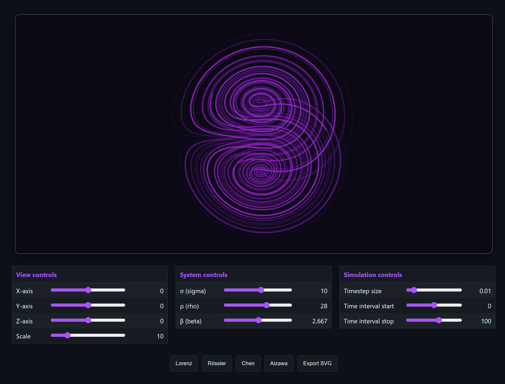
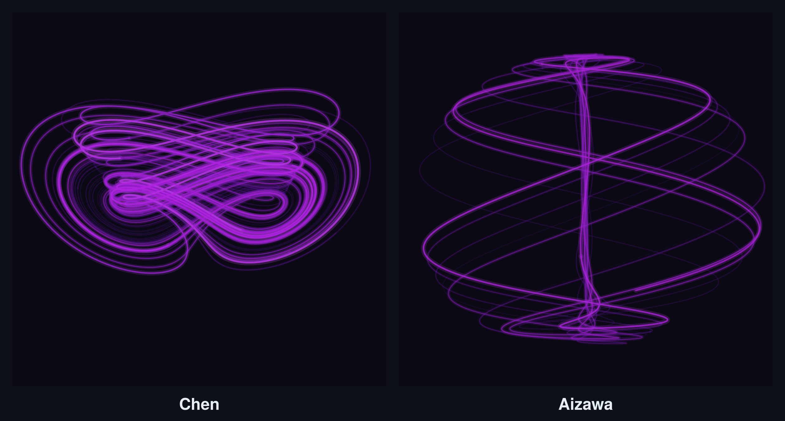

# my-avatar

Interactive 3D strange attractor visualizer and vector SVG exporter built to generate my GitHub profile picture.

Written by hand as a math and graphics exercise. The UI styling was AI-assisted.

**[Live demo](https://aaronpiipponen.github.io/my-avatar/)**

## Features

- Renders four 3D dynamical systems: Lorenz, Rössler, Chen, and Aizawa.
- Projects 3D trajectories onto an orthographic view plane with incremental rotation along the X, Y, and Z axes and adjustable scale.
- Adjusts system parameters (`σ`, `ρ`, `β`), Euler integration timestep size, and simulation time interval start and stop bounds.
- Shades Catmull-Rom spline segments by trajectory progression and depth along the viewing normal vector.
- Exports a centered square SVG (`600 px` by `600 px`) containing separate `glow-layer` and `core-layer` path groups.

## Screenshots


The visualizer with the default Lorenz preset.


Chen and Aizawa attractors exported with **Export SVG**.

## Repository layout

```text
├── index.html
├── style.css
├── assets/
│   ├── overview.png
│   └── examples.png
└── src/
    ├── main.js
    ├── attractors.js
    ├── math3d.js
    ├── renderer.js
    ├── controls.js
    ├── spline.js
    └── export.js
```

## Local setup

To run the visualizer locally instead of using the live demo:

1. Clone the repository and open the repository root directory.
2. Start a local static HTTP server so the browser loads the ES modules:

```bash
python -m http.server 5500
```

3. Open `http://localhost:5500` in a browser. The canvas displays the Lorenz attractor with default parameters.

## Attractor equations and presets

Selecting an attractor button loads preset parameters, timestep size, time interval bounds, and scale.

| Attractor | Differential equations | Preset parameters | Step | Interval | Scale |
| :--- | :--- | :--- | :--- | :--- | :--- |
| Lorenz | `dx/dt = a(y - x)`, `dy/dt = x(b - z) - y`, `dz/dt = xy - cz` | `a = 10`, `b = 28`, `c = 8/3` | `0.01` | `0` to `100` | `10` |
| Rössler | `dx/dt = -y - z`, `dy/dt = x + ay`, `dz/dt = b + z(x - c)` | `a = 0.2`, `b = 0.2`, `c = 5.7` | `0.05` | `0` to `400` | `14` |
| Chen | `dx/dt = a(y - x)`, `dy/dt = (c - a)x - xz + cy`, `dz/dt = xy - bz` | `a = 35`, `b = 3`, `c = 28` | `0.003` | `0` to `60` | `10` |
| Aizawa | `dx/dt = (z - b)x - dy`, `dy/dt = dx + (z - b)y`, `dz/dt = c + az - z^3/3 - (x^2 + y^2)(1 + ez) + fzx^3` | `a = 0.95`, `b = 0.7`, `c = 0.6` | `0.01` | `0` to `120` | `12` |

The Aizawa preset uses fixed constants `d = 3.5`, `e = 0.25`, and `f = 0.1`, and scales output coordinates by 15.

Integration always runs from `t = -500` to `t = 500`. Only points within the start and stop bounds are drawn. Points before `t = 0` act as a warm-up period so the trajectory settles onto the attractor before rendering.

## SVG export

1. Adjust the view axes, scale, system parameters, or simulation interval until the canvas shows the desired framing.
2. Select **Export SVG**.
3. The browser downloads `attractor.svg` with a `viewBox` of `0 0 600 600`, centered on the mean of the projected trajectory. The export matches the central 600 × 600 square of the canvas preview, so content outside that square is cropped.

## Troubleshooting

- **Blank canvas:** the canvas stays empty if the stop bound is not greater than the start bound or the trajectory diverges (integration halts at the first non-finite value). Reload a preset or the page to recover.
- **View won't return to the original angle:** view sliders apply incremental rotations, and 3D rotations don't commute, so moving sliders back to `0` doesn't necessarily restore the starting view. Reload the page to reset.

## Licence

MIT